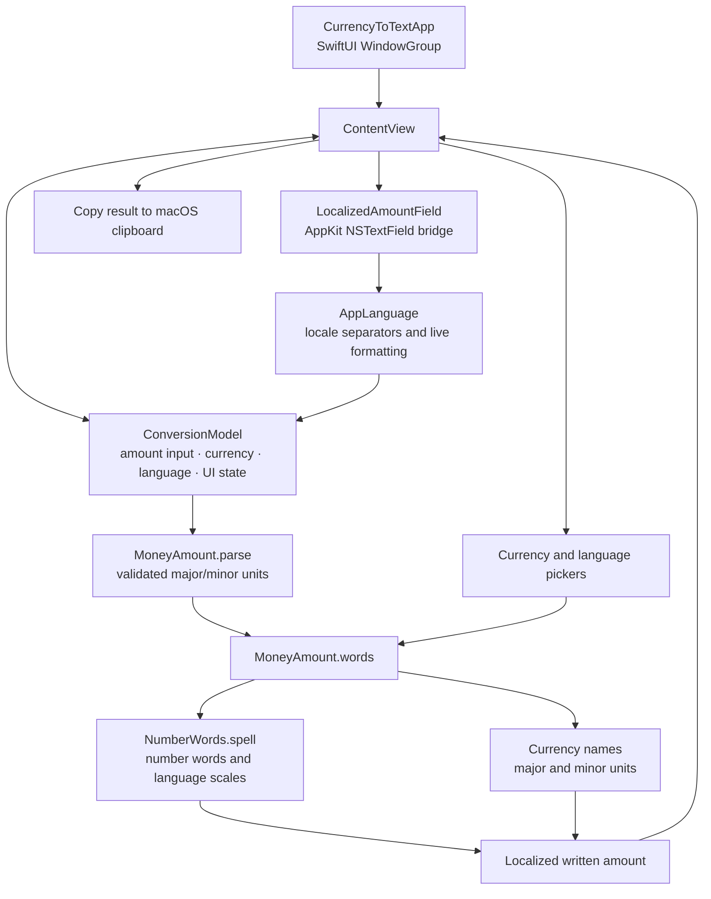
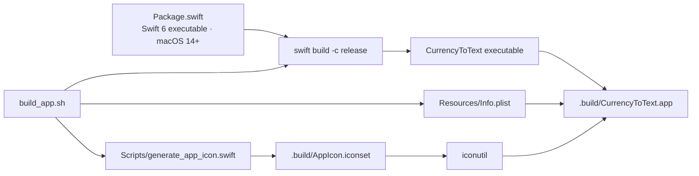

# Architecture

Currency to Text is a native macOS SwiftUI executable. Its main flow is local:
the user enters an amount, chooses a currency and language, and the UI derives
the written result from the current input and selections.

## Application and conversion flow

`ContentView` observes the `ConversionModel`; the displayed result is derived
from its current amount, currency, and language rather than stored separately.
`LocalizedAmountField` wraps an AppKit text field so it can insert locale
grouping separators while preserving the editing selection. The model stores
the normalized numeric input used by `MoneyAmount.parse`.

The supported currencies are EUR, USD, GBP, and BRL. Written output is
available in Portuguese, English, Spanish, German, Japanese, Russian, French,
Korean, and Simplified Chinese. Number spelling and currency-unit naming are
implemented in `NumberWords.swift` and `Currency.swift`.

## Build and app bundle

Run `./build_app.sh` to compile the release executable and assemble the
launchable `.app` bundle. The script copies the bundle metadata and executable,
generates the iconset, and converts it to the app's `AppIcon.icns` resource.

## Source map

| File | Responsibility |
|---|---|
| `Sources/CurrencyToText/CurrencyToTextApp.swift` | App entry point and window |
| `Sources/CurrencyToText/ContentView.swift` | UI, observable state, input-field bridge, clipboard |
| `Sources/CurrencyToText/Currency.swift` | Languages, currencies, amount parsing, formatting, currency wording |
| `Sources/CurrencyToText/NumberWords.swift` | Localized number-to-words algorithms |
| `Resources/Info.plist` | macOS app-bundle metadata |
| `Scripts/generate_app_icon.swift` | Creates PNG sizes for the macOS iconset |
| `build_app.sh` | Builds and assembles the `.app` bundle |
